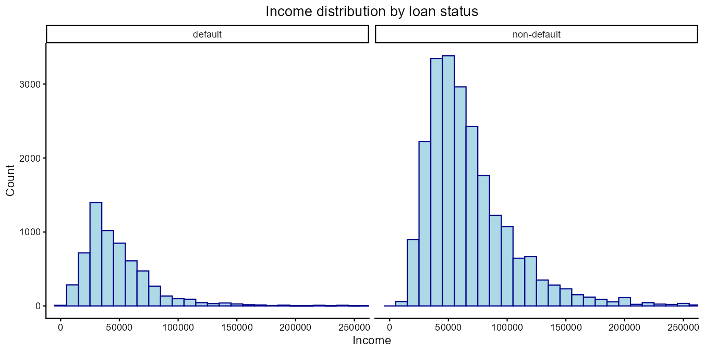
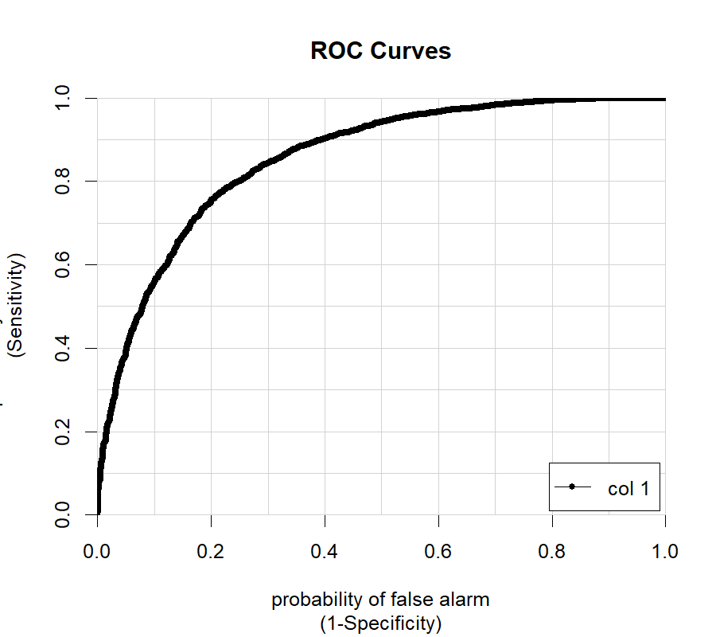

# Credit risk: what the loan data shows

R analysis of 32,581 loan records: cleaning, exploration, a regression of income, and a logistic model of who defaults.

**Full write-up:** https://yarida-cv.vercel.app/credit-risk.html

## Results

| Step | Result |
| --- | --- |
| Cleaning | 32,581 records → 28,578 after removing missing values, zero incomes, the ID and the grade columns |
| Default rate | 21.6% of loans defaulted (6,183 of 28,578) |
| Income regression | Age, home ownership, employment length, loan purpose, loan amount, interest rate, loan status, loan-to-income ratio and credit history explain about a third of the variation in income (R² 0.34). Backward stepwise selection dropped only the prior-default flag. |
| Logistic model of default | Forward stepwise selection kept 7 predictors: loan-to-income ratio, interest rate, home ownership, loan amount, loan purpose, employment length and age |
| Test-set performance (threshold 0.5) | Accuracy 0.845 · Sensitivity 0.473 · Specificity 0.951 · AUC 0.854 |

What the last line means: the model clears 95% of good loans correctly but catches fewer than half of the defaults at the 0.5 threshold. Since 78% of loans are repaid, a model that says "no default" to everyone is already 78% accurate, so sensitivity and AUC matter more than accuracy here.

## Files

- `credit_risk_analysis.R`: the whole analysis, top to bottom
- `data/credit_risk_dataset.csv`: the dataset used in the unit (a public credit-risk dataset)
- `outputs/`: charts, model summaries and the metrics, as produced by the script

## How to run

1. Install R and the packages `tidyverse`, `corrplot`, `rsample`, `yardstick` and `caTools`.
2. From this folder run `Rscript credit_risk_analysis.R`.
3. Charts and summaries appear in `outputs/`. The split uses `set.seed(123)`, so the numbers above reproduce.

## About this repository

This started as a group assignment of three students in ECOM5005 Business Analytics at Curtin University (October 2025). The cleaning, exploration and income-regression code is from our working file. The group's submitted file, which held the logistic model, was later lost, so the logistic section here was rebuilt afterwards following the assignment's steps (70/30 split stratified by loan status and purpose, seed 123, forward stepwise selection, evaluation on the test set). The numbers in this README come from running this script, not from the submitted report.

Author of this repository: Yarida Kaewthong.
